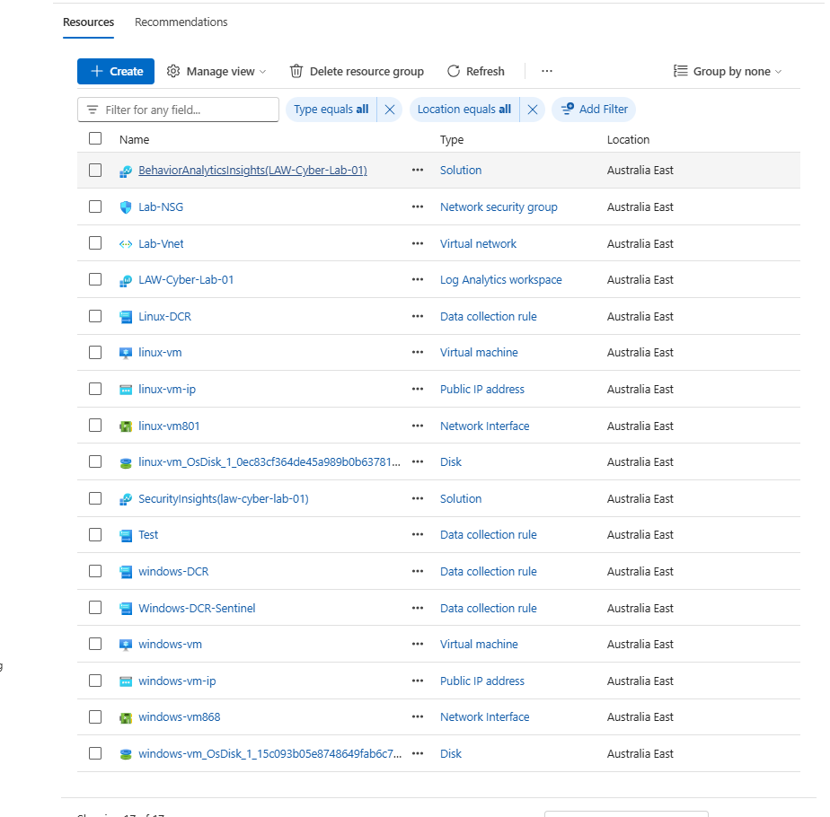
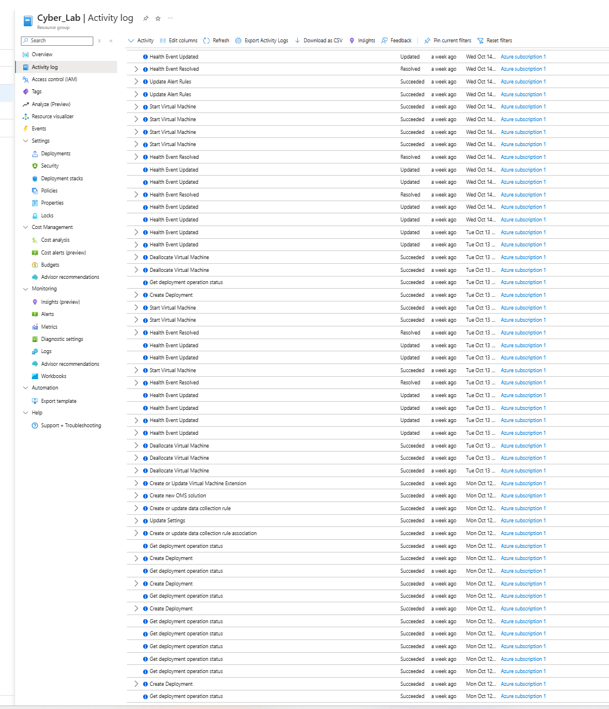
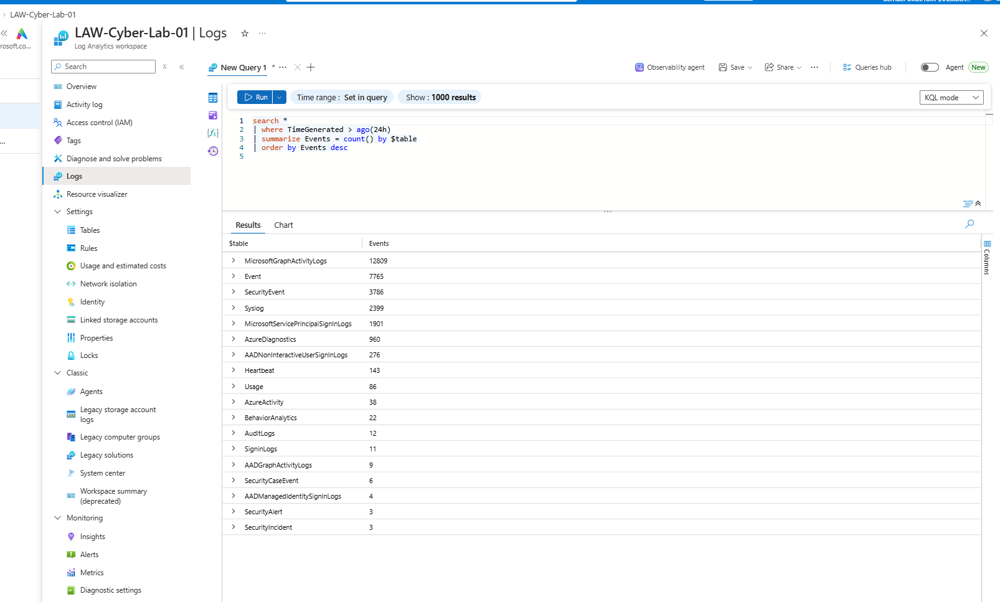
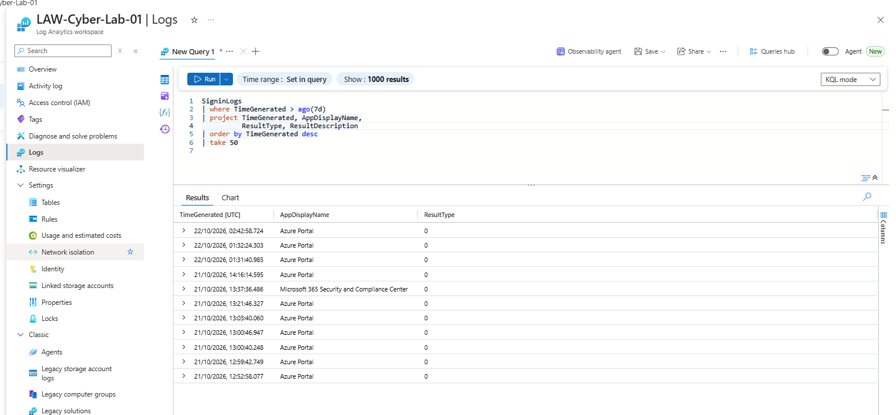
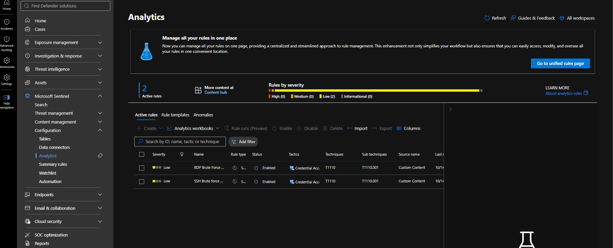

# Microsoft Sentinel SOC Homelab

## Project Overview

This project documents my hands-on cybersecurity lab using Microsoft Azure, Microsoft Sentinel and Log Analytics.

The lab focuses on collecting Windows and Linux security logs, investigating authentication activity, writing KQL queries and learning how security alerts can be detected and investigated.

## Lab Environment

- Microsoft Azure
- Windows 11 virtual machine
- Ubuntu Linux virtual machine
- Log Analytics workspace
- Microsoft Sentinel

## Project Objectives

- Understand how security logs are collected and stored.
- Investigate failed login attempts using KQL.
- Practise detecting potential SSH brute-force activity.
- Troubleshoot log collection and ingestion issues.
- Document investigation steps and security recommendations.

## Investigation Results
The following investigations were performed using Microsoft Sentinel and Log Analytics:

- **Windows authentication:** Investigated failed logon events (Event ID 4625) and reviewed repeated failures.
- **Linux SSH monitoring:** Queried Syslog data and reviewed related SSH security incidents.
- **Azure activity monitoring:** Reviewed Azure Activity Logs for resource operations and configuration changes.
- **Identity monitoring:** Queried Microsoft Entra ID sign-in logs to review authentication activity.
- **Detection rules:** Configured Sentinel analytics rules for SSH brute-force activity and RDP failed logons. The RDP-specific query returned no matching results during testing.

**Outcome:** Practised KQL queries, security log analysis, detection-rule configuration, and incident investigation.

*This is a learning lab. Findings are based on the available telemetry and require further validation.*


## Disclaimer

This is a hands-on learning project. All findings will be based on my own lab evidence and observations.

## Lab Architecture

The diagram below illustrates the lab's log collection and security monitoring flow.


## Azure Infrastructure Setup

I built my cybersecurity lab from scratch in Microsoft Azure.

### Resources Created
- Created an Azure Resource Group to organise lab resources.
- Built a Virtual Network and subnet.
- Configured Network Security Group (NSG) rules.
- Deployed a Windows 11 virtual machine.
- Deployed an Ubuntu Linux virtual machine.
- Created a Log Analytics workspace.
- Installed Azure Monitor Agent on Windows and Linux.


### Azure Resources

The Azure resource group contains the infrastructure used for this lab, including the virtual network, network security group, virtual machines, Log Analytics workspace, and data collection rules.




## Log Collection and Verification

I configured and verified log collection in my Log Analytics workspace to support security monitoring and investigation.

### Azure Activity Logs
- Verified that Azure Activity Logs were available for querying.
- Explored Azure control-plane activities, including resource and configuration changes.


#### Evidence

The Azure Activity Log shows control-plane operations performed during the lab setup, including virtual machine operations, deployments, and data collection rule changes.




### Azure Resource Logs
- Configured diagnostic settings for relevant resources.
- Verified that resource logs were arriving in the configured destination.

  
#### Log Analytics Table Verification

Queried the Log Analytics workspace to identify tables containing recent events. The results included Azure activity, diagnostic, Windows security, Linux Syslog, and sign-in log tables.




### Microsoft Entra ID Sign-in Logs
- Verified that sign-in logs were available for querying.
- Explored sign-in activity to understand identity and authentication risks.

  
#### Evidence

Queried Microsoft Entra ID sign-in logs to review recent authentication activity. The displayed records include successful sign-ins, identified by a ResultType of 0.




### Key Learning
Different log sources provide different insights. Azure Activity Logs help monitor management operations, resource logs provide service-specific information, and Entra ID sign-in logs support identity investigations.


## Microsoft Defender and Sentinel Configuration

### Microsoft Defender
- Accessed the Microsoft Defender portal and explored its security monitoring capabilities.
- Verified the Windows and Linux lab environments as part of the security monitoring setup.

### Microsoft Sentinel
- Enabled Microsoft Sentinel for the Log Analytics workspace.
- Explored the Sentinel dashboard and workspace features.
- Configured and explored data connectors.
- Queried collected security logs using Kusto Query Language (KQL).

### Windows and Linux Monitoring
- Configured and verified log collection from both Windows and Ubuntu Linux virtual machines.
- Explored Windows security events and Linux Syslog entries.
- Investigated authentication activity to identify suspicious login patterns.

### Key Learning
Learned how to collect and analyse logs from different operating systems, use Microsoft Sentinel for security monitoring, and investigate authentication activity using KQL.


## Microsoft Sentinel Analytic Rules

I explored how Microsoft Sentinel analytic rules can identify potentially suspicious activity from collected security logs.


### Active Analytic Rules — Evidence

The Sentinel Analytics page shows two enabled analytic rules: RDP Brute Force and SSH Brute Force. Both are configured with Low severity.




### 1. RDP Failed Login Attempts
- Objective: Identify repeated failed Remote Desktop Protocol (RDP) login attempts.
- Data source: Windows security events, where available.
- Detection approach: Analyse failed login events, source IP addresses, targeted accounts, and event frequency.
- Investigation: Review the results to determine whether the activity requires further investigation.

### 2. Microsoft Entra ID Sign-in Monitoring
- Objective: Monitor identity sign-in activity.
- Data source: Microsoft Entra ID sign-in logs.
- Detection approach: Examine failed sign-ins, unfamiliar locations, and unusual authentication patterns where the required data is available.

- ### Microsoft Entra ID — Sign-in Monitoring

**Objective:** Monitor authentication activity and identify potentially suspicious sign-in patterns.

**Data source:** Microsoft Entra ID sign-in logs (`SigninLogs`).

**KQL Query**

```kusto
SigninLogs
| where TimeGenerated > ago(7d)
| project TimeGenerated,
          UserPrincipalName,
          AppDisplayName,
          IPAddress,
          ResultType,
          ResultDescription
| order by TimeGenerated desc
```

**Findings**

- Retrieved sign-in records from the Log Analytics workspace.
- Observed successful sign-ins where `ResultType == 0`.
- Reviewed activity involving Azure Portal and Microsoft 365 Security and Compliance Center.

**Analysis**

The query provides visibility into sign-in timestamps, user accounts, applications, source IP addresses and authentication results. Successful authentication alone does not confirm whether activity is legitimate or suspicious.

**MITRE ATT&CK**

- **T1078 — Valid Accounts:** Relevant when investigating suspected misuse of legitimate accounts. The query alone does not establish this technique occurred.

**Recommended Actions**

- Review unfamiliar source IP addresses and unusual authentication patterns.
- Investigate failed sign-ins and correlate them with successful sign-ins.
- Review related alerts and incidents in Microsoft Defender when available.
- Validate suspicious activity before concluding that an account is compromised.

*This is a hands-on learning lab. Findings are based on observed log data and require further validation.*

### 3. Impossible Travel
- Objective: Identify sign-ins from geographically distant locations within a time interval that may be inconsistent with normal travel.
- Data source: Microsoft Entra ID sign-in data.
- Detection approach: Review location and timestamp information to identify potentially suspicious sign-in patterns.
- Investigation: Validate the events and consider VPN usage, proxy services, and other explanations before concluding that an account is compromised.


## SSH Failed Login Investigation

### Objective
Investigate failed SSH login attempts recorded in Linux Syslog using Kusto Query Language (KQL).

### Query
```kusto
Syslog
| where TimeGenerated > ago(24h)
| where SyslogMessage contains "Failed password"
| project TimeGenerated, Computer, HostIP, SyslogMessage
| order by TimeGenerated desc
```

### Evidence


### Analysis
The displayed logs contain repeated failed SSH password attempts involving different usernames, including `root`. These events can be indicators of password guessing or brute-force activity and require further investigation.

### Recommended next steps
- Group failed attempts by source IP and time window.
- Check whether any successful SSH logins followed the failures.
- Review the source IPs and authentication history for suspicious activity.
- Consider blocking confirmed malicious sources through the appropriate security controls.

*This is a learning lab. Conclusions should be based on the observed logs and further validation.*


### Windows Failed and Successful Login Investigation

**Objective**

Investigate failed and successful Windows logon events in Microsoft Sentinel using Kusto Query Language (KQL).

**Findings**

- Identified nine failed logon events (Event ID 4625) from source IP `117.20.68.46` targeting `windows-vm`.
- The failed attempts involved the account `MicrosoftAccount\cybercxel`.
- The failure status and substatus indicate invalid logon credentials and an incorrect password.
- Successful logon events (Event ID 4624) were also recorded from the same IP address, including Logon Types 3 and 10.

**Evidence**


**Analysis**

The combination of repeated failed attempts and successful logons from the same IP warrants further investigation. The available evidence does not establish whether the successful logons were authorised or whether the account was compromised.

**Recommended next steps**

- Verify whether the source IP and successful logons are expected.
- Review the account, authentication details and event timeline.
- Investigate related activity on the Windows VM.
- Escalate or contain the activity according to the organisation's incident response procedures if malicious activity is confirmed.

*This is a hands-on learning lab. Findings are based on observed lab logs and require further validation.*

### Additional Investigation

- Correlated failed logons (Event ID 4625) with successful logons (Event ID 4624) from the same source IP, `117.20.68.46`.
- Identified explicit-credential events (Event ID 4648) and process-creation events (Event ID 4688).
- Observed Windows processes including `svchost.exe`, `winlogon.exe` and `wininit.exe`.
- Process command-line details were unavailable through the query because `ProcessCommandLine` was not present in the current `SecurityEvent` schema.

### Conclusion

The combination of repeated failed logons and successful logons from the same source IP warrants further investigation. The available evidence does not confirm account compromise. Further validation of the source IP, authentication activity and endpoint logs would be required.

*This is a hands-on learning lab based on observed logs. Findings are limited to the available evidence.*
